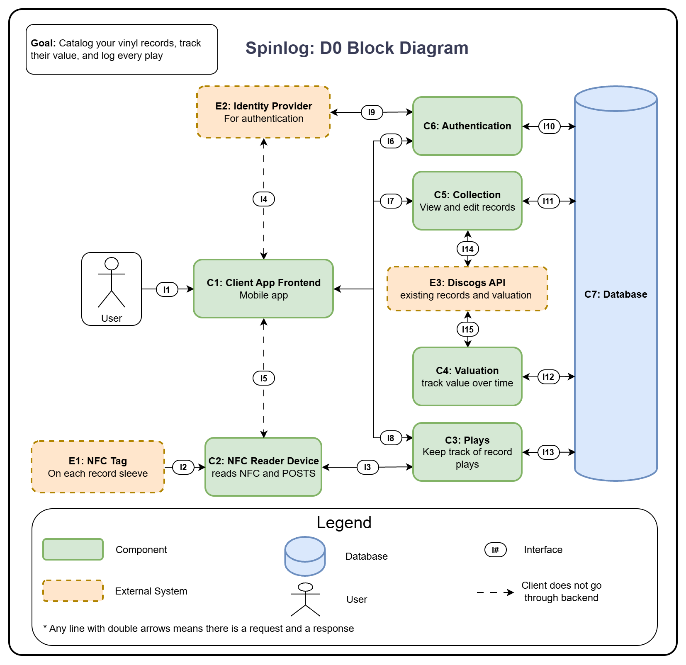
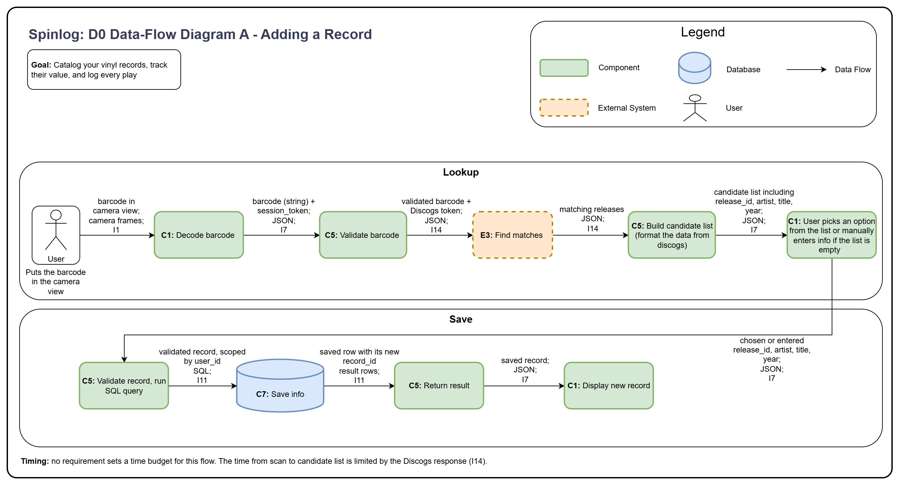
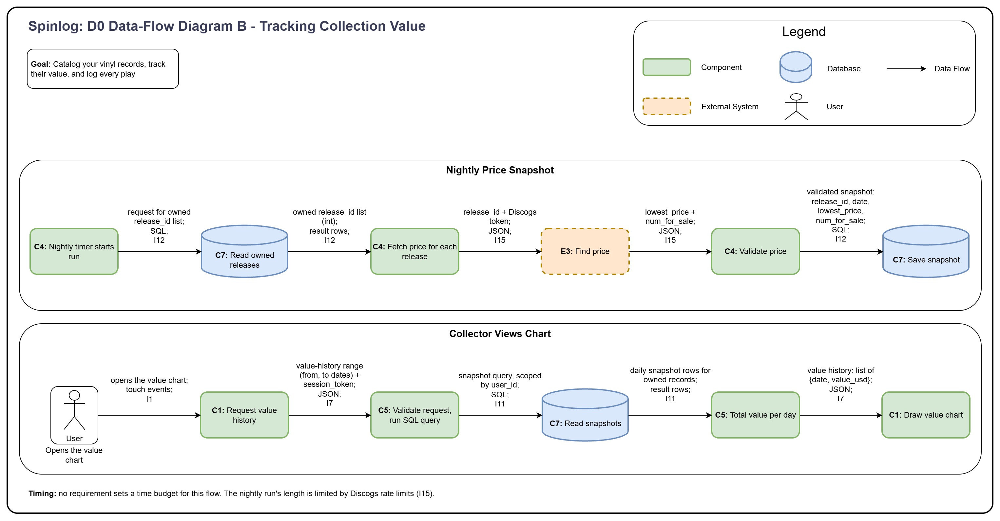
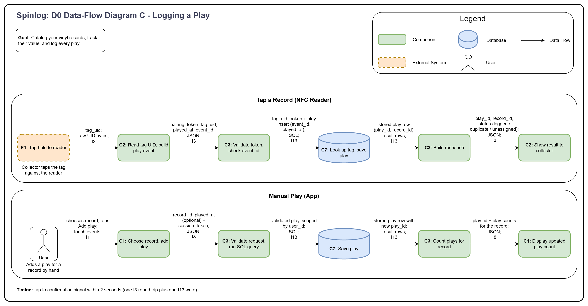

# Spinlog: D0 High Level System Design

**Team Members:** Marcus Rowe and Owen Mueller

---

## 1. Title, goal statement, and conventions

- **Title:** Spinlog
- **Goal:** Catalog your vinyl records, track their value, and log every play.
- **Basic Input:** Record details entered by collector, NFC tag taps, barcode scans, and daily price data from external API.
- **Basic Output:** Filtered collection views, chart of collection over time, and play counts for each album.

---

## 2. Block Diagram (the D0 diagram)



---

## 3. Component Responsibility Table

| ID | Component | Responsibility | In | Out | Owner |
|----|-----------|----------------|----|-----|-------|
| C1 | Client App Frontend | Shows the collector their library, value history, and play counts, and takes their input (barcode scans, manual edits, manual plays). | I1, I4, I5, I6, I7, I8 | I4, I5, I6, I7, I8 | Owen |
| C2 | NFC Reader Device | Reads a tag's UID and reports each tap to Plays, then signals whether it was logged. | I2, I3, I5 | I3, I5 | Marcus |
| C3 | Plays | Records each play event exactly once, whether it comes from the reader or from manual entry. | I3, I8, I13 | I3, I8, I13 | Marcus |
| C4 | Valuation | On a nightly timer, fetches Discogs prices for owned releases and stores them as snapshots. | I12, I15 | I12, I15 | Owen |
| C5 | Collection | Manages the collector's records and serves the collection and its value history, including barcode lookup. | I7, I11, I14 | I7, I11, I14 | Owen |
| C6 | Authentication | Establishes who is calling by signing users in through the identity provider and issuing the user and device credentials the other components check. | I6, I9, I10 | I6, I9, I10 | Marcus |
| C7 | Database | Stores users, devices, records, tag mappings, plays, and price snapshots. | I10, I11, I12, I13 | I10, I11, I12, I13 | Owen |

---

## 4. Interface Specification Table

Each interface covers both directions of a connection. **Inputs** is what the initiator sends, **Outputs** is what the responder returns, and **On error** lists what happens and which component handles it (in parentheses).

| ID: Connection | Inputs (initiator sends) | Outputs (responder returns) | Format | Protocol | On error (handler) |
|---|---|---|---|---|---|
| I1: User → C1 | taps, text fields (string), barcode frames (camera image) | screens, field errors, confirmations | touch events, camera frames, rendered UI | phone OS touch and camera APIs | invalid field: highlight it (C1); camera permission denied or barcode unreadable: offer retry or manual entry (C1) |
| I2: E1 → C2 | NFC read command | `tag_uid` (string, 14 hex chars) | raw UID bytes | NFC-A (ISO 14443-A) | read fails or times out: signal failure, nothing sent (C2) |
| I3: C2 → C3 | `pairing_token` (string), `tag_uid` (string, 14 hex), `played_at` (ISO 8601 UTC string), `event_id` (string, unique per device) | `play_id` (int), `record_id` (int or null), `status` (logged, duplicate, unassigned) | JSON | HTTPS POST | no network, timeout, or 500: keep the play in flash and retry with the same `event_id` (C2); 400 malformed: drop the event and signal failure (C2); 401 bad token: signal failure (C2); duplicate `event_id`: return the original `play_id` with duplicate (C3); unknown tag: store the play unassigned, return unassigned (C3) |
| I4: C1 → E2 | `client_id` (string), `redirect_uri` (string), `state` (string), `code_challenge` (string) | one-time `code` (string), `state` (string) | URL query parameters, redirect | HTTPS in the phone's browser view (OAuth 2.0 code flow with PKCE) | user cancels or provider denies: return to sign-in screen (C1); `state` mismatch: discard the response and restart (C1); provider unreachable: show "try again later" (C1) |
| I5: C1 → C2 | `ssid` (string), `password` (string), `pairing_token` (string) | `device_id` (string), `status` (connected, wrong_password, network_not_found, token_rejected) | JSON | BLE (GATT write and notify) | any non-connected status: show the matching message (C1); BLE drops mid-setup: discard partial settings (C2), offer to start over (C1) |
| I6: C1 → C6 | sign-in: `code`, `code_verifier`, `redirect_uri` (strings); refresh: `refresh_token` (string); new device: `session_token` (string) | `session_token` (string), `expires_in` (int, seconds), `refresh_token` (string), `pairing_token` (string, new-device only) | JSON | HTTPS REST (POST) | bad or expired code: reply 401, return to sign-in (C6, C1); session expired: refresh, else sign in again (C1); provider unreachable: reply 503 "try again later" (C6) |
| I7: C1 → C5 | `session_token` (header); filters (string), record fields (JSON), `barcode` (string, 8 to 14 digits), value-history range (two ISO dates) | records list, candidate releases (`release_id` int, `artist`, `title`, `year` int), saved record, value history (list of `{date, value_usd}`) | JSON | HTTPS REST (GET, POST, PUT, DELETE) | 400 invalid field: return which field (C5), highlight it (C1); 401: sign in again (C1); 403 another user's data: refuse and log (C5); 404: refresh list (C1); barcode no match: empty list, offer manual entry (C5, C1); Discogs busy or down: reply 503 (C5); database error: retry once, then 503 (C5) |
| I8: C1 → C3 | `session_token` (header); `record_id` (int), `played_at` (ISO 8601, optional, defaults to now); tag link: `tag_uid` (string), `record_id` (int) | `play_id` (int), play counts (list of `{record_id, count, last_played}`) | JSON | HTTPS REST (GET, POST) | 400 invalid: return field error (C3); 401: sign in again (C1); 403 another user's data: refuse and log (C3); 404 no such record: refresh list (C1); database error: retry once, then 503 (C3) |
| I9: C6 → E2 | `code`, `code_verifier`, `client_id`, `client_secret`, `redirect_uri` (strings), `grant_type` (string) | `id_token` (string), `access_token` (string), `expires_in` (int, seconds), `refresh_token` (string) | request: form-encoded; response: JSON | HTTPS POST | invalid or expired code: reply 401 to the app (C6); token fails verification: reject and log (C6); provider unreachable or timeout: reply 503, no retry (C6) |
| I10: C6 → C7 | users, devices, and token rows to insert, update, or query (`user_id` int, `device_id` string, token hashes) | result rows | SQL, result rows | PostgreSQL wire protocol over TLS | connection lost: retry once, then reply 503 to the app (C6); duplicate user: treat as an existing sign-in (C6) |
| I11: C5 → C7 | select, insert, update, delete on records, releases, tags, and snapshots, always scoped by `user_id` (int) | result rows | SQL, result rows | PostgreSQL wire protocol over TLS | connection lost: retry once, then reply 503 (C5); constraint violation (such as a tag already linked): reply 409 (C5) |
| I12: C4 → C7 | read owned `release_id` list (int); insert snapshot `{release_id, date, lowest_price, num_for_sale}` | result rows | SQL, result rows | PostgreSQL wire protocol over TLS | connection lost: retry, then abort tonight's run and resume tomorrow (C4); snapshot already exists for that date: overwrite it (C4) |
| I13: C3 → C7 | look up record by `tag_uid` (string); insert play `{event_id, device_id, record_id, played_at}`; select play counts | result rows | SQL, result rows | PostgreSQL wire protocol over TLS | connection lost: retry once, then reply 503 so the reader retries (C3); duplicate `event_id`: return the stored play as duplicate (C3) |
| I14: C5 → E3 | `barcode` (string, 8 to 14 digits), Discogs API token (string) | candidate releases (list of `release_id` int, `artist`, `title`, `year` int) | JSON | HTTPS GET | rate limited: reply 503 "lookup busy" (C5); no match: empty list (C5); timeout or Discogs down: reply 503 (C5) |
| I15: C4 → E3 | `release_id` (int), Discogs API token (string) | `lowest_price` (decimal, USD), `num_for_sale` (int) | JSON | HTTPS GET | rate limited: back off and continue (C4); release not found or no price: skip it and log (C4); Discogs down: write no snapshot tonight and retry tomorrow (C4) |

### Example payload for I3

Request (C2 → C3):

```json
{
  "pairing_token": "dk_9f2c7a41b6e8",
  "tag_uid": "04A35B12C87780",
  "played_at": "2026-10-27T22:18:04Z",
  "event_id": "reader-01-000412"
}
```

Response (C3 → C2):

```json
{ "play_id": 1873, "record_id": 212, "status": "logged" }
```

---

## 5. Data-flow Diagram

### Flow A: Adding a Record



### Flow B: Tracking Collection Value



### Flow C: Logging a Play



---

## 6. Architecture Pattern and Justification

This system combines three patterns, each governing a different part:

| Part of system | Pattern | Explanation |
|----------------|---------|-------------|
| Whole system | Client-server | The phone app (C1) and the reader device (C2) are clients. The Plays (C3), Valuation (C4), Collection (C5), and Authentication (C6) are on a server that answers requests over HTTPS. Clients never talk to the database directly. |
| App and server side (C1, C3, C4, C5, C6) | Layered (three layers) | Presentation layer (C1), application logic layer (C3, C4, C5, C6), and data layer (C7). Each layer talks only to the one beside it. External services are reached only from the logic layer (with the exception of I4, this is only one time and if the user choses to login with their email). |
| Reader device (C2) | Embedded sensor-actuator | The device senses (reads an NFC tag), forwards it, and signals the result. |

**Rejected pattern:** We rejected a microservices architecture because we are new to hosting. We decided it would be easier to have one deployable backend that is used for all backend components. Is this actually the case? Who knows, if we get to development and this ends up being a bad decision we may switch to microservices instead.

### Justification

| Criterion | How the chosen patterns meets it |
|-----------|----------------------------------|
| Fit to the problem | A collection belongs to one user and is read from their phone, while plays arrive from a separate device. Both need the same data, so a central server with one database fits. The reader has one narrow job which is the sensor-actuator, and layering keeps screens, rules, and storage apart so each can modify its own. |
| Team skills | It's only a two person team so we're trying to keep it has simple as possible. Firmware for the device is newest for us so we kept its job very narrow (C2). Hosting is also new to us so we chose one deployable backend and avoid running several services (Deployable backend includes C3, C4, C5, and C6). |
| Performance and timing | The target is from tap to LED confirmation within 2 seconds. That path is one device to server round trip and one database write. Other paths like barcode scanning depends on how long the call to Discogs takes. |
| Scalability | We don't intend to design for thousands right now only a few users, but using layering allows better scalability. We can improve each layer separately if needed. |
| Hardware constraints | An ESP32 has limited memory and processing power and can only run on 2.4 GHz Wi-Fi. Having this as only a sensor is the right call because it barely needs to process anything, basically just forwards the data to the server where the processing takes place. |

---

## 7. Decision Log

| Decision | Alternatives Considered | Rationale |
|----------|-------------------------|-----------|
| The user facing app is a mobile app. | Web app or mobile app and a web dashboard | Barcode scanning needs the phone camera, and phones have bluetooth to set up the device. |
| Plays are logged by tapping an NFC tag on the record's sleeve against a dedicated reader. | Phone-only NFC, Barcode or QR scan for plays, dedicated device that uses song recognition instead of NFC's | First issue was audio detection vs tapping. Audio detection would be more thorough but more complex. We chose NFC as a starting point because it gives the hardware component that we can add onto later. |
| Discogs in the single external source for catalog data and pricing. | Separate sources for catalog data vs pricing | We previously had separate data sources for pricing, barcodes, and logs, but we realized discogs had all three so we'll try to use that for all of them first. |
| Reader joins the Wi-Fi through a one time Bluetooth setup from the app. | Hardcode credentials, temporary network setup | Bluetooth is the smoothest connection for the user. Hard coding works for development but not implementation. The paring token also lets the device prove who it belongs to. |
