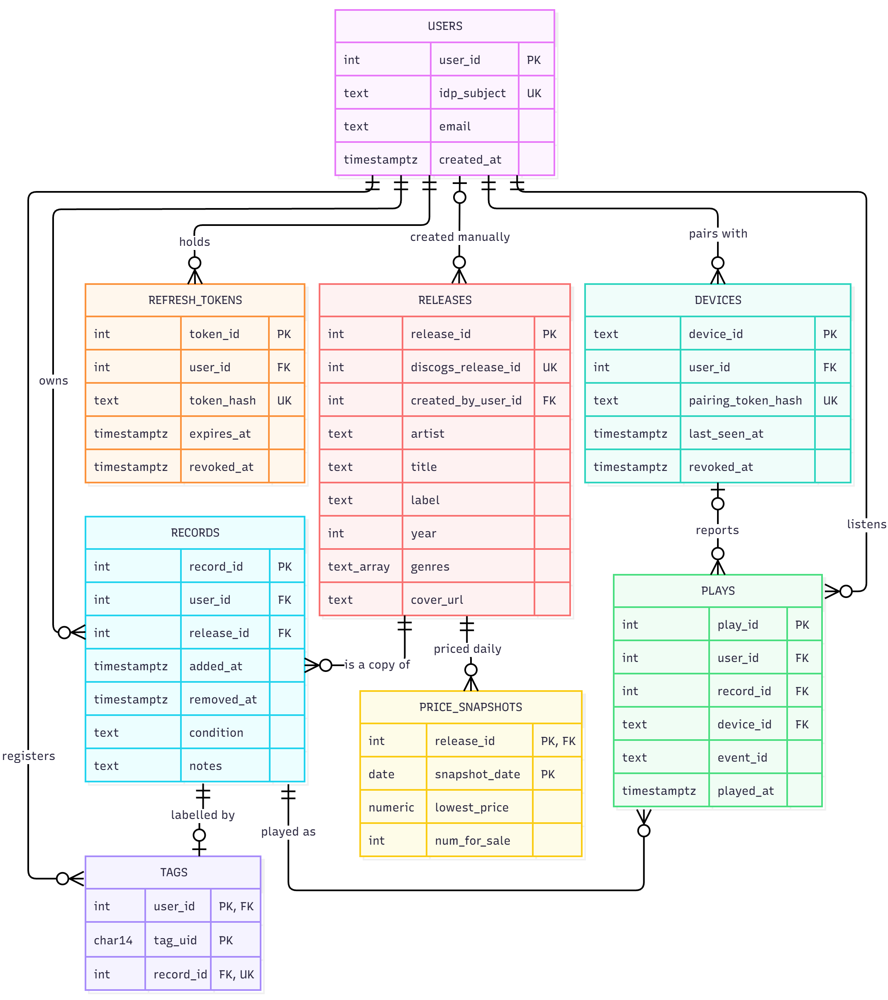

# Spinlog: D1 Detailed Design

**Team members:** Marcus Rowe, Owen Mueller

---

## 1. Header, scope, and conventions

**Title:** Spinlog

**Goal:** Catalog your vinyl records, track their value, and log every play.

**Scope:** D1 will detail components C7 (data model) and C3 (essential algorithm). All other components will be deferred to D2.

**Conventions:**

For Figure 1:

- Each colored table is an entity, with the name at the top.
- The three columns in each table are: data type, name, type of key
- PK – Primary Key, FK – Foreign Key, UK – Unique Key
- Any entity with multiple PKs means it's a composite PK
- The lines are connections between tables.
  -  - Exactly one
  -  - Zero or one
  -  - Zero or many

---

## 2. Data model, the D1 diagram

**Figure 1: C7 Database Model**



**Structural Decisions:**

| Decision | Justification | Requirement(s) |
|---|---|---|
| Users -> Devices is one to many | A user may have multiple vinyl players. If they do, they could potentially have multiple devices that contribute to their plays. | US-03 |
| Releases vs Records | RELEASES is one per release (individual record). This is pulled from discogs. RECORDS is the mapping for which user has each release. These are separated so that multiple copies of the same song information isn't needed, multiple people can have the same record and it only needs to be stored once. | US-01 |
| Relational Database (PostgreSQL) | The data is connected (users, copies, releases, plays, prices) and needs joins for value history. It also needs uniqueness guarantees, like not double counting a play, that the database can enforce for us. | US-01, US-02, US-03 |
| Records are soft deleted (`removed_at`) instead of removed | Value history is built from dates, so hard deleting a record would silently change past totals on the chart. | US-02 |
| A play's record is required | A tap on a tag that isn't assigned yet does not log a play. It shows red on the reader to let the user know there is an error, and it needs to be assigned. | US-03 |
| Hand-entered albums get a release row with no Discogs ID | When a barcode isn't found and/or no satisfactory record is found on Discogs, the collector enters the album manually. The valuation job skips these because there's no price to look up. `created_by_user_id` keeps them private. | US-01 |
| A play's device is optional, `user_id` is stored on the play directly | Plays added by hand in the app have no reader. Storing the user on every play ensures each play can always be scoped to its owner. | US-03 |
| PLAYS has a unique constraint on (`device_id`, `event_id`) | The reader retries with the same `event_id` if the network drops. The database refuses the second insert, so a play is counted exactly once even when two arrive together. | US-03 |

---

## 3. Core algorithms

### Play Tracking Algorithm

**What it is and the problem it solves:**

This algorithm details the C3 component. When the reader detects an NFC tag, it sends the tap to C3 (by I3). C3 needs to work out which record the tag belongs to and save one play for it. This is the main feature the product depends on (US-03), so it has to do three things:

- Count each listen exactly once. The reader keeps a tap in flash and retires with the same `event_id` if the network drops.
- Count a play only against a record. If the tag isn't linked to a record yet, no play is saved.
- Ignore an accidental double tap of the same record

**Procedure:**

1. Validate the input fields. Return 400 if bad.
2. Authenticate the device. Hash `pairing_token` and find the device where the has matches and `revoked_at` is null. This gives `device_id` and `user_id`. No matches return a 401.
3. Check for an exact retry. If a play with this `device_id` and `event_id` exists, return it as duplicate.
4. Find the record. Join TAGS to RECORDS for this user and `tag_uid`. If there is none, save nothing and return unassigned.
5. Ignore a double tap. If a play of the same record exists within 10 seconds either side of `played_at`, return it as duplicate.
6. Insert the play and return logged.

**Inputs and outputs:**

Inputs: `pairing_token` (string), `tag_uid` (string), `played_at` (string), `event_id` (string)

Outputs: `status` (string – logged, duplicate, or unassigned), `play_id` (int or null), `record_id` (int or null)

**Expected complexity:**

Every step is one indexed lookup or write, that is O(log n) per request. At our expected size (&lt;20 users, tapping every few minutes), the database should take a millisecond or two, inside the 2 second tap-to-LED target in D0.

**Why this rather than alternatives:**

One alternative we rejected was saving plays for unlinked tags with no record, then attaching them later. We rejected it because this would let PLAYS hold plays that mean nothing yet, and it's just another step later to re-assign them. We chose instead that every play has a record, so a tap on an unlinked tag is refused. Another alternative we considered was prompting the user in the app when an unlinked tag is tapped. This just wasn't possible because D0 has no way for the server to reach the app, so it would need a push interface or a stored table of held taps. Instead, we will handle this with a specific "linking" pipeline, which will be detailed in D2.

**Edge cases:**

| Case | Behavior | Ties to |
|---|---|---|
| Retry of a tap already saved | Return the original `play_id` with duplicate. No new row. | I3, I13 |
| Many retries of one tap arrive at the same time | The unique constraint lets one insert win, the return duplicate | I13 |
| Tag not linked to any record | Nothing saved, returns unassigned and device shows red light | I3 |
| Bad pairing token | Returns a 401, nothing saved, red light | I3 |
| Connection lost | Retry once, then returns a 503 | I13 |

---

## 4. Build-versus-reuse decisions

| Piece | Build/Reuse | Library | License | Reason |
|---|---|---|---|---|
| Data Schema | Build | N/A | N/A | We need entities, attributes, and relationships specific to this project. |
| Database | Reuse | PostgreSQL | PostgreSQL license (free and open to use for personal and commercial) | Free to use and standard database software, both team members are already familiar |
| Database access from Python | Reuse | SQLAlchemy with psycopg 3 | SQLAlchemy: MIT. psycopg: LGPL-3.0-only | SQLAlchemy is the standard to connect to postgre from python, and psycopg has basic built in sql-injection protection |
| API framework | Reuse | FastAPI | MIT | Routing, JSON, and error responses come built in |
| Pairing token generation and hashing | Reuse | Python standard library | Python Software Foundation License | Comes built into python, works great for everything we're doing |
| Play tracking | Build | N/A | N/A | This is project-specific logic, nothing off the shelf is quite what we need |
| Backend Server | Reuse | Uvicorn | BSD-3-Clause | Standard server for FastAPI, lots of documentation |

---

## 5. API Contract

**Endpoint Name:** `POST /api/v1/taps`

**Description:** This endpoint details the interface I3, between C2 and C3.

**Inputs (request body):**

| Field | Type | Required | Valid Range |
|---|---|---|---|
| `pairing_token` | string | Required | 1-128 characters |
| `tag_uid` | string | Required | Exactly 14 hexadecimal characters |
| `played_at` | string | Required | ISO 8601 UTC timestamp ending in Z |
| `event_id` | string | Required | 1-64 characters |

**Outputs (response body):**

| Field | Type | Meaning |
|---|---|---|
| `status` | string | logged (new play saved), duplicate (play was already saved), unassigned (tag not linked to a record, nothing saved) |
| `play_id` | int or null | The saved play, for duplicate it is the original, for unassigned it is null |
| `record_id` | int or null | The record the play belongs to, unassigned = null |

**Error Responses:**

| HTTP status | Error code | When it happens | Reader response |
|---|---|---|---|
| 400 | `invalid_field` | A required field is missing, wrong type, or outside valid range | Drops event and shows red |
| 401 | `invalid_token` | `pairing_token` matches no device or device was revoked | Drops event and shows red |
| 503 | `database_unavailable` | Database connection lost and retry failed | Keep the request in flash and try again later |
| 500 | `server_error` | Any other server error | Keep the request in flash and try again later |

**Example:**

Request

```json
{
  "pairing_token": "dk_9f2c7a41b6e8",
  "tag_uid": "04A35B12C87780",
  "played_at": "2026-10-27T22:18:04Z",
  "event_id": "reader-01-000412"
}
```

Response

```json
{
  "play_id": 1873,
  "record_id": 212,
  "status": "logged"
}
```

**Versioning:**

The version is embedded in the url path (/v1/). Adding an optional request field or a new response field is not a breaking change. Removing or renaming a field, adding a new required request field, or changing a fields type is a breaking change and requires /v2/.

---

## 6. Technology choices

**Database: PostgreSQL**

**Team skill fit:** Both team members have experience using it. **Licensing:** Free for personal and commercial use. **Community support:** Well documented and widely used, lots of tutorials and information about how to get it set up and use it. **Performance:** Far exceeds what we expect to need, but is light enough to be good for smaller projects as well. **Cost and hosting:** Free, can run on a personal computer. SQLite is simpler to set up, but it is a single file that lives with one program and only lets one person write at a time, which doesn't fit our needs.

**API: FastAPI (Python)**

**Team skill fit:** Marcus has used Python professionally and written API endpoints in C#/.NET so the ideas carry over, a difference that will need adjusting to is that FastAPI uses rules rather than code. **Licensing:** FastAPI is MIT, and the pieces it depends on are permissive as well (Pydantic is MIT, Uvicorn is BSD-3-Clause). **Community Support:** It was released in 2018 and widely used in production. It has thorough official documentation and a large number of tutorials, which is great for a team new to hosting. **Performance:** Far exceeding what we expect to need. It's built to handle production level throughput. **Cost and hosting:** Free to use and runs as one process, which fits D0's single deployable backend. Another option considered was ASP.NET with C# because of Marcus's experience but Python has more beginner hosting guides and keeps everything in the same language.

**Phone App: React Native**

**Team skill fit:** Marcus has used React professionally and React native uses the same way of building screens, so the main difference will be translating that to a phone screen instead of a desktop. **Licensing:** React Native is MIT. The NFC and barcode libraries will have their own licenses, which we will check in D2. **Community Support:** React Native is widely used in cross-platform frameworks, and community libraries exist for reading a tag's ID and scanning barcodes with a camera. **Performance:** Fine for a collection of 1,000 or more records as long as the list is drawn with a scrolling list. **Cost and hosting:** Free to build and test on our own phones. Paid developer accounts are required to publish to the app store, which won't be needed for a demo. Some alternatives we considered were Flutter and separate Swift and Kotlin apps but we stuck with React because of our experience.

**Reader hardware: ESP32**

**Team skill fit:** Owen has experience with C++ (which is what ESPs are programmed in) and Marcus has used ESP32s before for personal projects. **Licensing:** Many ESP32 software tools are open source. **Community Support:** Huge hobbyist communities exist for ESP32s, so things like NFC reading, Wi-fi setup, and pairing have examples we can learn from. **Performance:** Limited memory and processing power and only 2.4GHz Wi-Fi, but should work for our simple job. Wi-fi and Bluetooth are built in. **Cost and hosting:** Low cost for board and NFC module, you can usually pick one up for around \$10 (and we already have some). We also considered a Raspberry Pi Zero but it costs more and is overkill for the simple NFC reading job.

**Hosting: self-hosted on a team computer**

**Team skill fit:** Hosting is new to us, so we run the backend and PostgreSQL on a team member's computer which we can start, stop and debug directly. **Licensing:** No hosting provider terms, but the software runs with the licenses described in section 4. **Community Support:** Docker and Uvicorn are well documented for local development. **Performance:** this will be good for a few users, but it is not meant for production. **Cost and hosting:** free, this is the main reason we chose this option. The main problem with this is that the personal computer has to be on and running the backend for the app to work. This is fine for personal use but if we wanted to upgrade to an actual product we would need paid, always on hosting. We considered such a host like Neon but decided against it because we didn't want to have to pay. Also, the constraints specify TLS, but our demo will run on a private network without TLS. If we actually deployed, this would be part of our consideration.
