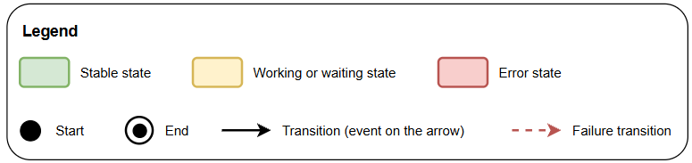
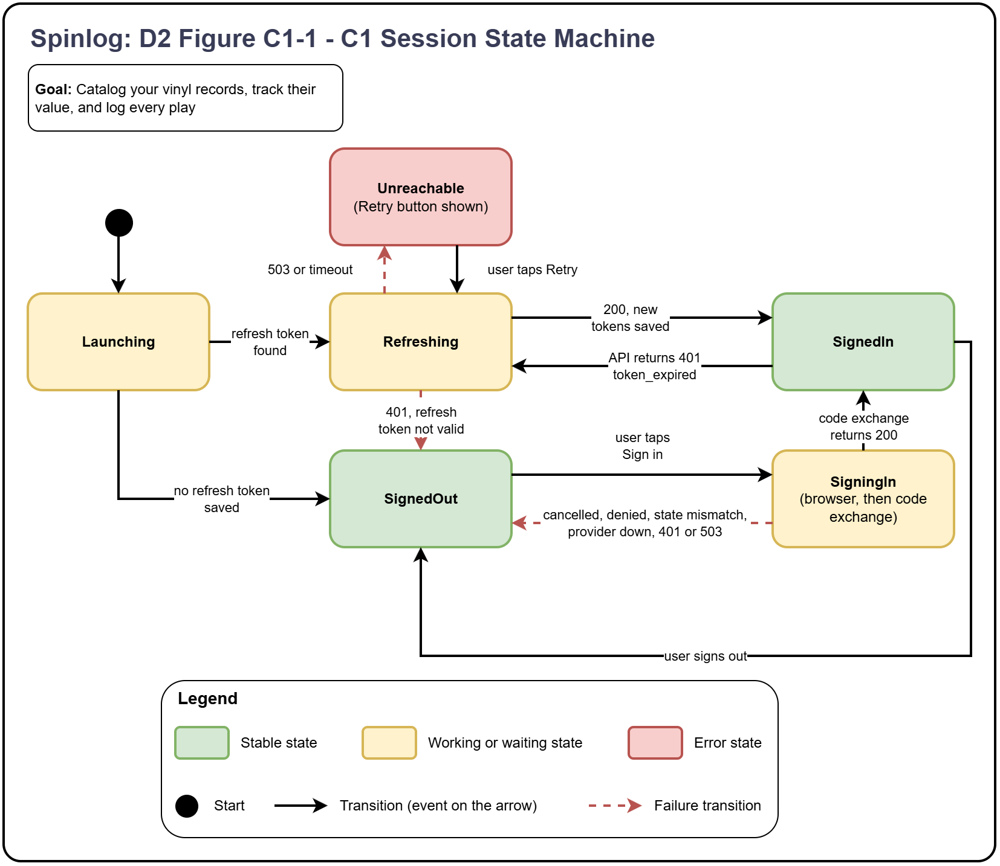
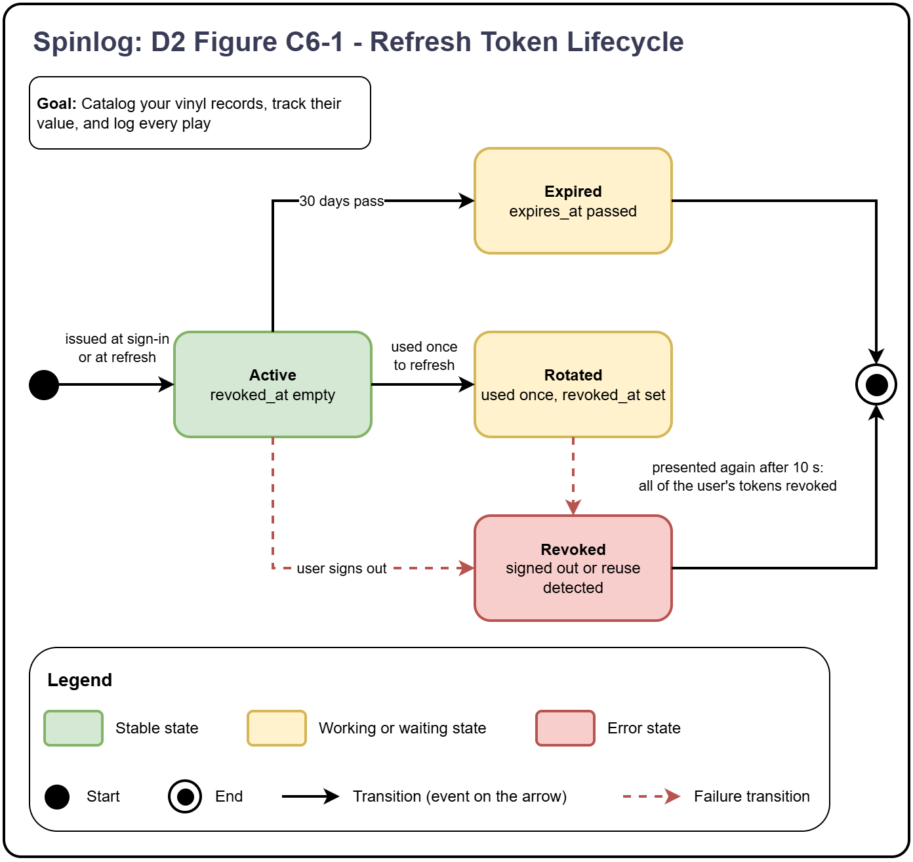

# Spinlog: D2 Detailed Design

**Team Members:** Marcus Rowe and Owen Mueller

## 1. Title, goal statement, and conventions

**Title:** Spinlog

**Goal:** Catalog your vinyl records, track their value, and log every play

**Conventions:**

**Overview:** Spinlog is a vinyl record collection inventory and tracking app. It is made to allow you to catalog your records, track their value over time, and log every play and track play stats. D1 covered components C3 (Plays) and C7 (database) which detailed the main play tracking and tagging algorithm along with the database schema. This document details the rest of the components and their interfaces including C1 (Client App Frontend), C2 (NFC Reader Device), C4 (Valuation), C5 (Collection), and C6 (Authentication).

**Known gaps and open questions:**

| ID | Gap/question |
|---|---|
| Q1 | C5 interface (Owen): I7 has no barcode lookup endpoint, so the app can’t get candidates before saving |
| Q2 | Logging a play by hand (Marcus and Owen): I8 isn’t defined yet, should have been done in D1 |
| Q3 | Tag linking in C3 (Marcus): Unclear until we start testing. |
| Q4 | C2 tables (Marcus): I5 doesn’t list Bluetooth characteristics, we won’t know until we start testing. |
| Q5 | Identity provider (Marcus and Owen): hasn’t been chosen yet |
| Q6 | TLS (Marcus and Owen): in our constraints essay but doesn’t necessarily apply for a demo |

## 2. Finished Components

### 2.1: C1 - Client App Frontend

#### 2.1.1: Data Model

C1 has no persistent server data, C7 holds that. The phone keeps:

| Item | Where kept | Content | Lifetime |
|---|---|---|---|
| refresh_token | OS secure storage | opaque string issued by C6 | Until sign-out or server revokes it |
| api_base_url | App settings | Server address | Until changed |
| session_token, expires_at | Memory | Access token | Lost when app closes, rebuilt from the refresh token at launch |
| Collection page, filters, value history, play counts, pairing pages | Memory | Responses from I7 and I8 | Screen lifetime |

#### 2.1.2: Behavior

Screens (accessed through I1):

| ID | Screen | Purpose | Calls |
|---|---|---|---|
| S1 | Sign in | Start sign-in with the identity provider (see Figure C1-1) | I4, I6 |
| S2 | Library | List, filter by artist, genre, decade, keyword search, record count | I7 |
| S3 | Record details | Details, play count and last played, log play, link tag, edit, remove | I7, I8 |
| S4 | Add record | Scan barcode, pick a candidate, or enter by hand | I1, camera, I7 |
| S5 | Value chart | Collection value over time with ranges | I7 |
| S6 | Readers | List readers, pair new | I5 |
| S7 | Reader setup | Set up a reader | I5 |
| S8 | Link | Read a tag with the phone | I1, I8, NFC |

Navigation is three tabs (Library, Value, Readers) plus the detail and wizard screens

**Figure C1-1: Session State Machine**

This figure details the session state of the front-end app.

Add a record by barcode steps (S4):

1. S4 opens the camera (with a permission check).
2. First valid read (8-14 digits) stops the scan. No read after 30s shows “Can’t read code, please try again”. An option for manual entry is also offered.
3. Send barcode (I7). Empty list: offer manual entry. 1 or more: show candidates.
4. User picks one, C1 sends the release_id to save. Success: back to S2 with the new record.
5. Manual entry: artist and title required, year, condition, and notes optional.

Link a tag to a record steps (S8):

1. From S3, tap Link tag. Check NFC is supported and on.
2. Show “Hold the tag to the back of your phone” and read the UID.
3. Verify UID format, if not 7 bytes show “This tag type isn’t supported”.
4. Send the link (I8). 200: show “Linked”. 409: Tag already linked, offer replace which unlinks the old pairing and then links the new one.

#### 2.1.3 Interface:

C1 owns two interfaces, I1 and I4. Every other interface C1 uses (I5, I6, I7, I8) is defined in the section of the component that owns it.

**I1, User to C1:**

| Screen | What the user does | What the user sees | Format |
|---|---|---|---|
| S1 Sign in | Tap Sign in | Sign-in button; a short message if the provider cannot be reached | Touch screen |
| S2 Library | Filter choices (artist, genre, decade), search text, scroll, tap a record | Record list with cover, artist, title, year, play count; total count; empty-state messages | Touch screen |
| S3 Record detail | Tap Log play, Link tag, Unlink, Edit (condition, notes), Remove | Record details, play count, last played, link status, confirmations | Touch screen |
| S4 Add record | Point the camera at a barcode, pick a candidate, or type artist, title, genre, year | Camera view, candidate list, form with field errors, "Saved" confirmation | Camera, touch screen |
| S5 Value chart | Pick a range | Line chart of collection value; a single number if there is only one data point | Touch screen |
| S6 Readers | Tap Pair new reader, tap Revoke on a reader | List of readers with last seen time and revoked state | Touch screen |
| S7 Reader setup | Pick the Wi-Fi network, type its password, confirm the server address | Step-by-step progress and the reader's status (connecting, connected, wrong password, and so on) | Touch screen, Bluetooth |

**I4, C1 to Identity Provider (E2)**

| Item | Detail |
|---|---|
| Input (C1 sends) | The provider's sign-in page is opened in the phone's browser with: client_id, redirect_uri, response_type=code, scope, state, code_challenge, code_challenge_method=S256 |
| Output (C1 receives) | The browser returns to the app's redirect address with: code, state |
| Format | HTTPS in the system browser, returning through a redirect address registered for the app |
| What C1 does next | Checks that state matches what it sent, then passes code and code_verifier to C6 (see C6's section for that endpoint) |
| Open item | Which identity provider and the exact redirect address are still undecided (Q1) |

### 2.2: C2 - NFC Reader

#### 2.2.1: Data model

The reader stores two things:

1. Device settings: Device ID, pairing token, and Wi-Fi name and password, which is received during setup.
2. Tap queue: Taps kept in flash until they are sent.

#### 2.2.2: Behavior

When a tag is read:

1. Read the tag’s ID. If the read fails or times out, signal a failure and send nothing.
2. Send the tap to Plays with the tag ID, played_at time, and an event ID. The event ID is unique per device.
3. Act on the response:
    - a. Logged or duplicate: signal success.
    - b. Unassigned: signal red. Plays saves nothing.
    - c. 400 malformed: drop the tap and signal a failure.
    - d. 401 bad token: signal a failure.
    - e. No network, timeout, or 500: keep the tap in flash and retry with the same event ID.

When the app sets up the reader:

1. Receive the Wi-Fi name, Wi-Fi password, and pairing token over Bluetooth.
2. Reply with the device ID and a status: connected, wrong_password, network_not_found, or token_rejected.
3. If Bluetooth drops during setup, discard partial settings.

#### 2.2.3: Interfaces

C2 owns I2, I5, and its own light and button. It sends two requests to the server: one POST for every tap (I3), and one GET for a time and token check (I14). Both are defined by the owning component, C3 in D1 section 5 and C6, so only what the reader does is listed here.

**Requests C2 Sends:**

| Endpoint | When | Request | Success response | Format |
|---|---|---|---|---|
| POST /api/v1/taps (I3, to C3) | After every accepted tap, and for each saved tap that is resent | Body: pairing_token, tag_uid, played_at, event_id | 200: status (logged, duplicate, unassigned, or linked), play_id, record_id. The reader only reads status | JSON over HTTP |
| GET /api/v1/devices/me (I16, to C6) | After each Wi-Fi join and at power up, and at the end of setup | Header: X-Pairing-Token. No body | 200: device_id, server_time. The reader sets its clock from server_time | JSON over HTTP |

**I2, E1 to C2**

| Item | Detail |
|---|---|
| Input | NFC-A tag held to reader |
| Output | UID bytes, turned into tag_uid |
| Format | NFC-A |

**I5, C1 to C2 (BLE)**

| Item | Detail |
|---|---|
| Input (App writes) | server_url, ssid, password, pairing_token, commit |
| Output (Reader writes) | status |
| Format | JSON over BLE |

**Light (C2 to user)**

| Light | Meaning |
|---|---|
| Blue, pulsing | Setup mode is on/ pairing |
| Green | Play logged |
| Red | Tap not saved or not paired |

**Button (User to C2)**

Holding the button for 3 seconds starts setup mode. The reader advertises over Bluetooth. Holding for 10 seconds factory resets the Wi-fi settings, server address, and pairing token.

### 2.3: C4 - Valuation

Every night, C4 fetches the current Discogs price for each release that a user still owns and save one price snapshot per release per day.

#### 2.3.1: Data Model

Stores: PRICE_SNAPSHOTS from D1 Figure 1

| Column | Type | Key | Meaning |
|---|---|---|---|
| release_id | Int | PK, FK | Which release |
| snapshot_date | Date | PK | Which day |
| lowest_price | numeric |  | Lowest current listing, USD. Empty if no listing |
| num_for_sale | Int |  | Number of copies listed |

Reads RECORDS and RELEASES to find which releases are owned.

#### 2.3.2: Behavior

- If a run is already in progress, stop.
- Read the owned releases that have a Discogs ID. Skip hand entered releases.
- For each release, skip it if a snapshot already exists for today.
- Wait if needed to stay under Discogs’ request limit.
- Ask Discogs for the price and handle the answer:
    1. Price found: Save the snapshot. If snapshot already exists for today, leave it as is.
    2. No listings: Save nothing.
    3. Release not found: Skip it.
    4. Rate limited: Slow down requests and continue.
    5. Discogs down: Save nothing for this release, try again tomorrow.
- If saving fails, retry once. If it fails again, stop tonight’s run and try again tomorrow.
- The newest snapshot_date is the date of the last successful run.

#### 2.3.3: Interfaces

C4 has no endpoints of its own, it is a nightly job that nothing calls. It makes one call to Discogs (I15) and database calls.

**I15, C4 to Discogs (E3)**

| Item | Details |
|---|---|
| Endpoint | GET https://api.discogs.com/marketplace/stats/{release_id}?curr_abbr=USD |
| Input | release_id, curr_abbr=USD |
| Headers | Authorization: Discogs token=<key> (key read from settings). User-Agent: the app's name and version, which Discogs asks every client to send |
| Output | 200: num_for_sale, lowest_price, blocked_from_sale. C4 stores lowest_price.value as lowest_price and num_for_sale as num_for_sale |
| Empty result | A release with nothing for sale, or one blocked from sale, returns null for lowest_price and num_for_sale. C4 treats both as no listing (EC-24) |
| Format | JSON over HTTPS GET |

**I12, C4 to the database (C7)**

| Operation | Table | Input | Output |
|---|---|---|---|
| List owned releases | RECORDS joined to RELEASES | None | Release ID and Discogs ID for every release a user still owns (removed_at empty) that has a Discogs ID, listed once each |
| Check snapshot exists | PRICE_SNAPSHOTS | release_id, snapshot_date | Yes or no. Looked up by the table's primary key |
| Save snapshot | PRICE_SNAPSHOTS | release_id, snapshot_date, lowest_price, num_for_sale | The new row. A second save for the same release and date is refused by the primary key |

### 2.4: C5 - Collection

#### 2.4.1: Data model

Uses RECORDS, RELEASES, and TAGS from D1 figure 1.

#### 2.4.2: Behavior

**Add by barcode:**

1. Check if the user already has 1000 records, if so stop with an error.
2. Look up the barcode on Discogs and return the matches.
3. When a user picks a match, reuse the release if it exists. If not, create it.
4. Create the record with today’s date as added_at.

**Add by hand:**

1. Check if the user already has 1000 records, if so stop with an error.
2. Ask the user for the artist, title, genre, and year.
3. Create a release with no Discogs ID and created_by_user_id set to the user.
4. Create the record.

**Remove:**

1. Set removed_at to the date. The row is never fully deleted.

**Edit:**

1. Change condition and notes only.

**Filter and search:**

1. Artist, genre, and decade filters combine with AND.
2. Keyword search matches artist, title, or label.
3. Results are sorted by date added, newest first, with a total count of records.

**Value over time:**

For each day in range:

1. Find the records owned that day: added on or before that day, and not removed after it.
2. For each record, use the newest price snapshot on or before that day.
3. Add the prices for the day’s total. Return the number of records with a price and the number owned.

**Link a tag:**

1. The app opens a session for a record that exists, isn’t removed, and has no tag. A new session replaces the user’s open one.
2. The user taps the tag. C3 checks for an existing tag match first. If there is none, it checks for this user’s open session.
3. If the session is still open and this user hasn’t already linked the tag, C5 saves the tag to the record and closes the session. The tap is not counted as a play.
4. C3 returns “linked”.

**Unlink a tag:**

1. Delete the tag row for this user.

#### 2.4.3: Interfaces

C5 owns I7, I11, and I14.

**I7, C1 (front end app) to C5**

| Action | Endpoint | Success | Errors |
|---|---|---|---|
| List or filter | GET /api/v1/records | Records and total counts | 400 bad field, 401: sign in again 403: refuse and log 404: refresh the list |
| Add by barcode | POST /api/v1/records | Saved record | 400 missing field 409 limit reached |
| Add by hand | POST /api/v1/records/manual | Saved record | 400 missing field 409 limit reached |
| Edit | PATCH /api/v1/records/{id} | Updated record | 400, 404 |
| Remove | DELETE /api/v1/records/{id} | 204 | 404 |
| Value over time | GET /api/v1/value-history?from=&to= | Per day: total, priced count, owned count | 400 bad dates. 503 database error after retry |
| Start link | POST /api/v1/link-sessions | Session open | 404 not found, 409 removed or already linked |
| Check link | GET /api/v1/link-sessions/current | Session details | 404 no open session |
| Cancel link | DELETE /api/v1/link-sessions/current | 204 |  |
| Unlink | DELETE /api/v1/tags/{tag_uid} | 204 | 404 |

**I11, C5 to the database (C7)**

| Operation | Tables | Input | Output |
|---|---|---|---|
| Count a user's records | RECORDS | user_id | Number of records with removed_at empty |
| List, filter and search records | RECORDS, RELEASES, TAGS, PLAYS | user_id, filters, limit, offset | Matching records with release details, tag_uid, play_count and last played, and the total |
| Find or create a release | RELEASES | discogs_id, or artist, title, genre, year and created_by_user_id | release_id. An existing release is reused, a new one is inserted |
| Add, edit, remove a record | RECORDS | release_id and user_id, or record_id with condition and notes, or record_id | The saved row. Remove sets removed_at and keeps the row |
| Read value history | RECORDS, PRICE_SNAPSHOTS | user_id, from, to | For each day: sum of the newest snapshot price on or before the day, count priced, count owned |
| Save or delete a tag | TAGS | user_id, tag_uid, record_id | The saved row, or the row removed. A tag already linked is refused by the primary key, and a record that already has a tag by its unique key |

**I14, C5 to Discogs (E3)**

| Item | Detail |
|---|---|
| Endpoint | GET https://api.discogs.com/database/search?barcode={barcode}&type=release |
| Input | barcode (string, in the query). type=release limits results to releases |
| Headers | Authorization: Discogs token=<key> (read from settings) User-Agent: the app's name and version |
| Output | 200: results[], each with id, title, year, cover_image, genre, label |
| Empty result | results is an empty list. C5 returns an empty items list to the app |
| Format | JSON over HTTPS GET |

### 2.5: C6 – Authentication

C6 signs users in through the identity provider (E2), issues the credentials other components check, and manages paired readers.

#### 2.5.1: Data Model

No persistent data itself - C6 writes three tables from D1 Figure 1

| Table | C6 action | Rules |
|---|---|---|
| USERS | Create on first sign-in | Idp_subject is unique |
| REFRESH_TOKENS | Insert at sign-in and refresh, set revoked_at on use, logout, or reuse | Only the hash is stored, expires after 30 days |
| DEVICES | Insert at pairing, set revoked_at, and update last_seen_at | hash is stored |

#### 2.5.2: Behavior

**Sign-in:**

1. Validate code, code_verifier, and redirect_uri are present, if not 400.
2. Send those with client_id and client_secret to the provider’s token endpoint (I9). If the provider can’t be reached, 503.
3. Verify the id_token.
4. Insert the user if idp_subject is new, otherwise update the email.
5. Create the session token and a refresh token. Return both

**Figure C6-1**

**Sign-out:** Hash the refresh token, set revoked_at if it’s present. Answer 204.

**Pair a reader:** Verify session, generate device_id with pairing token, store the hash, and return both.

**Revoke a reader:** Verify session, set revoked_at.

#### 2.5.3: Interfaces

C6 owns I6, I9, and I10.

**I6, C1 (front end app) to C6**

| Action and endpoint | Sent with | Request | Success response |
|---|---|---|---|
| Sign in POST /api/v1/auth/token | None | Body: code, code_verifier, redirect_uri | 200: session_token, expires_in, refresh_token |
| Refresh POST /api/v1/auth/refresh | None | Body: refresh_token | 200: session_token, expires_in, and a new refresh_token. The old one stops working |
| Sign out POST /api/v1/auth/logout | None | Body: refresh_token | 204, no body |
| Pair a reader POST /api/v1/devices | Session token | No body | 201: device_id, pairing_token |
| List readers GET /api/v1/devices | Session token | No body | 200: items[] of device_id, last_seen_at, revoked_at. The caller's own readers only |
| Revoke a reader DELETE /api/v1/devices/{device_id} | Session token | No body | 204, no body |
| Reader check-in GET /api/v1/devices/me | Pairing token | Header: X-Pairing-Token. No body | 200: device_id, server_time. Also updates last_seen_at |

**I9, C6 to identity provider (E2)**

| Call | Endpoint | Input | Output |
|---|---|---|---|
| Token request | POST to the provider's token endpoint | Form-encoded: grant_type=authorization_code, code, code_verifier, client_id, client_secret, redirect_uri | 200 JSON: id_token, access_token, expires_in, refresh_token |
| Provider keys | GET on the provider's public key list | None | 200 JSON: the keys used to check id_token signatures. |

**I10, C6 to the database (C7)**

| Operation | Table | Input | Output |
|---|---|---|---|
| Find or create a user | USERS | idp_subject, email | user_id. A second sign-in with the same idp_subject is treated as the same user |
| Save, find, revoke refresh tokens | REFRESH_TOKENS | user_id, token hash, expiry; or a hash to look up; or user_id to revoke all | The row, with revoked_at set when used, signed out or reused |
| Create, list, revoke readers | DEVICES | user_id, token hash; or user_id; or device_id | device row. Counts the user's active readers (limit 5) |
| Find a reader by token | DEVICES | token hash | device_id and user_id where revoked_at is empty. Also sets last_seen_at |

### 2.6: Glue Components

| Component | Data model | Behavior | Interface |
|---|---|---|---|
| Authentication | See 2.5.1 | See 2.5.2 | See 2.5.3 |
| Notifications | No persistent data | Spinlog does not send any push, email or text. The user sees results in two places. The reader LED shows green (logged) and red(rejected). The app shows banners, field errors, and confirmations. | No separate interface. LED results come from the I3 response. In app messages come from errors on I5, I6, I7, and I8. |
| Configuration | No database table. Server values live in environment variables, phone values live in app settings, and reader values live in flash memory. | The server reads its settings once at startup and doesn’t start if any required values are missing. Some settings include: identity provider client ID and secret, session lifetime, refresh lifetime, Discogs key, and database address. | No interfaces. |
| Logging | There are no database tables for logging. Plain text logs can go to the server console for debugging. | Some potential logged events could be sign in succeeded or failed, 401 and 403 refusals, database retries, or unassigned taps. | No interfaces. |

## 3. Edge cases and error handling

Categories: B = Boundary Values, T = Timing and concurrency, I = Bad or missing Input, X = External Dependencies

| ID | Component | Cat | Edge case | Design Decision |
|---|---|---|---|---|
| EC-01 | C1 Client App | B | User adds the 1,001st record | Surface error: "Collection is full". Handler: C1 add-record screen (S4). Recoverable: Yes, after removing a record |
| EC-02 | C1 Client App | T | Session token expires during several calls | Retry: one shared refresh, then retry each call once. Handler: C1 API wrapper. Recoverable: Yes |
| EC-03 | C1 Client App | T | Double tap on Save or Log play | Degrade: disable the button until the reply; never auto-retry a POST. Handler: C1 screens (S3, S4). Recoverable: Yes |
| EC-04 | C1 Client App | I | Barcode not 8 to 14 digits | Surface error: ignore the read, keep scanning. Handler: C1 scanner (S4). Recoverable: Yes |
| EC-05 | C1 Client App | I | No barcode read in 30 s | Fall back: "Can't read code" with Retry or manual entry. Handler: C1 scanner (S4). Recoverable: Yes |
| EC-06 | C1 Client App | X | Server unreachable or 503 | Degrade: "Can't reach server" with Retry, stay signed in. Handler: C1 API wrapper. Recoverable: Yes, when the server is back |
| EC-07 | C1 Client App | X | Bluetooth off or denied | Surface error: prompt to enable it, wizard waits. Handler: C1 setup wizard (S7). Recoverable: Yes |
| EC-08 | C1 Client App | X | Refresh token rejected (401) | Fall back: delete it and go to sign-in. Handler: C1 session manager. Recoverable: Yes |
| EC-09 | C2 NFC Reader | B | Tap queue full (100 taps) | Degrade: drop the oldest tap. Handler: C2 sender. Recoverable: No, the dropped play is lost |
| EC-10 | C2 NFC Reader | T | Same tag held on the reader | Degrade: ignore until it leaves for 1 s and 3 s pass. Handler: C2 tap handler. Recoverable: Yes |
| EC-11 | C2 NFC Reader | T | Power cut after read, before reply | Retry: tap was saved to flash first, resend with same event ID. Handler: C2 sender. Recoverable: Yes |
| EC-12 | C2 NFC Reader | I | Tag read fails or times out | Surface error: red, nothing saved. Handler: C2 tap handler. Recoverable: Yes, tap again |
| EC-13 | C2 NFC Reader | I | Tag is not a 7-byte UID | Surface error: red, nothing saved. Handler: C2 tap handler. Recoverable: Yes, use NTAG213 or NTAG215 |
| EC-14 | C2 NFC Reader | X | Wi-Fi down, server off or slow, 500 or 503 | Retry: keep tap, resend with same event ID, wait 5 s doubling to 5 min; amber LED. Handler: C2 sender. Recoverable: Yes |
| EC-15 | C2 NFC Reader | X | Server answers 401 (revoked or bad token) | Surface error: red, stop sending, clear the queue. Handler: C2 sender. Recoverable: Yes, after pairing again |
| EC-16 | C2 NFC Reader | X | Wrong Wi-Fi password in setup | Surface error: report wrong_password, keep old settings. Handler: C2 setup handler. Recoverable: Yes |
| EC-17 | C3 Plays | B | played_at more than 5 min in the future | Surface error: 400 invalid_field. Handler: C3 tap handler. Recoverable: Yes, reader clock is corrected |
| EC-18 | C3 Plays | T | Same tap retried several times at once | Fall back: unique rule lets one win, rest return duplicate. Handler: C3 tap handler. Recoverable: Yes |
| EC-19 | C3 Plays | T | Two taps of one record at the same moment | Fall back: lock the record row, handle one at a time. Handler: C3 tap handler. Recoverable: Yes |
| EC-20 | C3 Plays | I | Missing or malformed field | Surface error: 400 invalid_field, reader drops it. Handler: C3 tap handler. Recoverable: No, that tap is dropped |
| EC-21 | C3 Plays | I | Tag not linked to a record | Surface error: save nothing, return unassigned (red), unless a link session is open (see EC-32). Handler: C3 tap handler. Recoverable: Yes, user links the tag |
| EC-22 | C3 Plays | I | Bad or revoked pairing token | Surface error: 401 invalid_token. Handler: C3 tap handler. Recoverable: Yes, after pairing again |
| EC-23 | C3 Plays | X | Database connection lost | Retry once, then 503; reader resends. Handler: C3 tap handler. Recoverable: Yes |
| EC-24 | C4 Valuation | B | Release has no listings, or price is 0 | Degrade: save nothing. Handler: C4 nightly job. Recoverable: Yes |
| EC-25 | C4 Valuation | T | Second run starts while one is running | Degrade: stop (database lock held by the first). Handler: C4 nightly job. Recoverable: Yes |
| EC-26 | C4 Valuation | T | Run killed halfway | Fall back: next run skips releases with today's snapshot. Handler: C4 nightly job. Recoverable: Yes |
| EC-27 | C4 Valuation | T | Server off at the nightly time | Fall back: catch-up run when the server starts. Handler: C4 scheduler. Recoverable: Yes, missed days stay empty |
| EC-28 | C4 Valuation | I | Price not a number, or negative | Degrade: skip the release and log it. Handler: C4 nightly job. Recoverable: Yes, next night |
| EC-29 | C4 Valuation | X | Discogs rate limited | Retry: slow down; skip a release after 3 slow-downs. Handler: C4 nightly job. Recoverable: Yes |
| EC-30 | C4 Valuation | X | Discogs down | Degrade: save nothing; stop the run after 5 failures in a row. Handler: C4 nightly job. Recoverable: Yes, tomorrow |
| EC-31 | C5 Collection | B | Add at 1,000 records | Surface error: 409 limit_reached. Handler: C5 record service. Recoverable: Yes, after removing a record |
| EC-32 | C5 Collection | T | Link session never finished | Fall back: expires after 2 minutes. Handler: C5 link service. Recoverable: Yes, start a new link |
| EC-33 | C5 Collection | T | Record removed or tagged while link session open | Surface error: 409, close session, tap not counted as a play. Handler: C5 link service. Recoverable: Yes |
| EC-34 | C5 Collection | I | Missing artist or title | Surface error: 400 naming the field. Handler: C5 record service. Recoverable: Yes |
| EC-35 | C5 Collection | I | Another user's record ID | Surface error: 403, refuse and log. Handler: C5 record service. Recoverable: No, refused |
| EC-36 | C5 Collection | X | Discogs rate limited or down | Degrade: 503 "lookup busy", app offers Retry or manual entry. Handler: C5 lookup service. Recoverable: Yes |
| EC-37 | C5 Collection | X | Discogs no match for the barcode | Degrade: empty list, app offers manual entry. Handler: C5 lookup service. Recoverable: Yes |
| EC-38 | C5 Collection | X | Database connection lost | Retry once, then 503. Handler: C5 record service. Recoverable: Yes |
| EC-39 | C6 Authentication | B | Session token expired | Surface error: 401 token_expired, app refreshes. Handler: C6 token check. Recoverable: Yes |
| EC-40 | C6 Authentication | B | Sixth reader paired (limit 5) | Surface error: 409 device_limit. Handler: C6 pairing handler. Recoverable: Yes, after revoking one |
| EC-41 | C6 Authentication | T | Two refreshes with one token at once | Fall back: row lock, one wins, the other gets 401. Handler: C6 refresh handler. Recoverable: Yes |
| EC-42 | C6 Authentication | T | Used refresh token presented again after 10 s | Surface error: treat as stolen, revoke all the user's refresh tokens, log, 401. Handler: C6 refresh handler. Recoverable: Yes, user signs in again |
| EC-43 | C6 Authentication | I | Unknown, expired or revoked refresh token | Surface error: 401 invalid_refresh. Handler: C6 refresh handler. Recoverable: Yes, sign in again |
| EC-44 | C6 Authentication | I | Revoke another user's reader | Surface error: 403, refuse and log. Handler: C6 pairing handler. Recoverable: No, refused |
| EC-45 | C6 Authentication | X | Identity provider unreachable or no answer in 5 s | Surface error: 503 identity_provider_unavailable, no retry. Handler: C6 sign-in handler. Recoverable: Yes, user tries again |
| EC-46 | C6 Authentication | X | Provider down while users are signed in | Degrade: signed-in users keep working (tokens checked locally). Handler: C6 token check. Recoverable: Yes |
| EC-47 | C6 Authentication | X | Database connection lost | Retry once, then 503 database_unavailable. Handler: C6 handlers. Recoverable: Yes |
| EC-48 | C7 Database | B | Text over the limit | Surface error: caller replies 400, nothing written. Handler: C3 and C5 input checks. Recoverable: Yes |
| EC-49 | C7 Database | B | Price too large for numeric(10,2) | Surface error: refuse the write. Handler: C7 column types. Recoverable: Yes |
| EC-50 | C7 Database | T | Same play inserted twice | Fall back: unique (device_id, event_id) refuses the second. Handler: C7 constraint. Recoverable: Yes |
| EC-51 | C7 Database | T | Same tag inserted twice | Fall back: unique rules refuse the second; caller returns 409 or keeps the old row. Handler: C7 constraints. Recoverable: Yes |
| EC-52 | C7 Database | I | Required value missing | Surface error: not-null rule refuses, caller replies 400. Handler: C7 constraints. Recoverable: Yes |
| EC-53 | C7 Database | X | PostgreSQL stopped or host off | Degrade: callers retry once and reply 503; readers keep taps; nightly job waits. Handler: C3, C4, C5, C6 callers. Recoverable: Yes, when the team restarts it |
| EC-54 | C7 Database | X | Wrong database address | Surface error: server won't start, names the setting. Handler: Server startup check. Recoverable: Yes, after the team fixes it |
| EC-55 | C7 Database | X | Disk fails | Fall back: restore the nightly pg_dump copy. Handler: The team. Recoverable: Partly, up to a day of data lost |

## 4. Requirements traceability table

The project has five user stores and a few constraints in the Constraints Essay and D0. That isn’t quite enough for a full traceability table, so this table keeps those and adds NEW requirements where necessary. Any rows marked with NEW in the source identify these.

Priority: Must = product does not work without it, Should = expected but a demo can run without.

### 4.1: Functional Requirements

| ID | Requirement | Source | Priority | Design elements | How satisfied | Edge cases |
|---|---|---|---|---|---|---|
| FR-01 | Add a record by barcode (picking a Discogs match) or by hand | US-01 | Must | POST /api/v1/records, POST /api/v1/records/manual (I7); Discogs search GET /database/search?barcode= (I14); RELEASES, RECORDS; C1 barcode steps (S4) | Barcode: S4 scans, C5 looks it up on Discogs, the user picks a match, and C5 reuses or creates the release. By hand: a release with no Discogs ID, private to the user, which C4 skips. | EC-01, 04, 05, 31, 34, 36, 37 |
| FR-02 | List the collection, filter by artist, genre and decade, keyword search, show a count | US-01 (AC-01.1 to 01.4) | Must | GET /api/v1/records (I7); C5 filter and search steps; RELEASES genres, year, label; RECORDS | Filters combine with AND, keyword matches artist, title or label, and the reply carries the total count. No match is an empty list, not an error (AC-01.2), so the app keeps the filters visible. | EC-02, 06 |
| FR-03 | Edit condition and notes, and remove a record | US-01, US-02 | Should | PATCH /api/v1/records/{id}, DELETE /api/v1/records/{id} (I7); RECORDS removed_at | Only condition and notes can change. Remove sets removed_at and never deletes the row, so old totals stay the same. | EC-35, 48 |
| FR-04 | Show what the collection is worth over time | US-02, US-04 | Must | GET /api/v1/value- history?from=&to= (I7); C5 value- over-time steps; C4 nightly steps; GET /marketplace/stats/{release_id} | C4 saves one snapshot per release per day and skips a release already done today, so a rerun is safe. C5 adds up the newest price on or before each day for the records owned that day. | EC-24 to 30, 49, 51 |
| FR-05 | Log a play by tapping a tag on the reader | US-03 | Must | POST /api/v1/taps (I3, D1 section 5); C3 algorithm (D1 section 3, steps 3 and 5); PLAYS unique (device_id, event_id); C2 tap steps; reader light | The reader sends the 7-byte UID with an event ID, and the result shows on its light (logged, duplicate, unassigned, rejected). A retry reuses its event ID so the database refuses a second row, and a tap of the same record within 10 s is returned as duplicate. | EC-09 to 15, 17 to 23, 50 |
| FR-06 | The reader keeps taps during an outage and sends them later | NEW (derived US-03) | Should | C2 tap queue in flash (C2 data model); C2 behavior step 3e; GET /api/v1/devices/me (I16) for the time | Each tap is saved to flash before it is sent and removed only after a reply. Resends reuse the event ID. | EC-09, 11, 14 |
| FR-07 | Link an NFC tag to a record | US-03 (NEW, derived) | Must | POST /api/v1/link-sessions, GET and DELETE /api/v1/link- sessions/current, DELETE /api/v1/tags/{tag_uid} (I7); C5 link and unlink steps; TAGS (PK user_id+tag_uid, record_id UK) | The app opens a 2 minute link session, the user taps the tag on the reader, C3 sees the tag is new and C5 saves it. That tap is not counted as a play. | EC-21, 32, 33, 51 |
| FR-08 | Set up a reader from the phone | US-03, D0 decision log, NEW | Must | POST /api/v1/devices, GET /api/v1/devices, DELETE /api/v1/devices/{device_id} (I6); Bluetooth setup (I5); GET /api/v1/devices/me (I16); DEVICES revoked_at; C2 setup steps | The app creates the pairing token, writes the Wi-Fi settings and token over Bluetooth, and the reader reports a status. Revoking sets revoked_at, so the reader's next tap gets 401. | EC-07, 15, 16, 22, 40, 44 |
| FR-09 | See how often each record was played | US-03 | Must | PLAYS; I11 list operation (reads play count and last played); GET /api/v1/records (I7) | The app calls api/v1/records which routes to C5 through I7, and returns all record information for that user from I11 and back through I7 | EC-38 |
| FR-10 | Log a play by hand from the record screen | NEW (S3 Log play, D0 I8) | Should | I8 (C1 to C3); PLAYS with no device, needs an endpoint | We need to write an endpoint for this | EC-03 |
| FR-11 | Sign in with an existing identity provider account, stay signed in, and sign out | NEW (D0 I4, I9) | Must | POST /api/v1/auth/token, /auth/refresh, /auth/logout (I6); I4; I9; USERS idp_subject; REFRESH_TOKENS; Fig C1-1, C6-1 | The app sends the provider's code, C6 verifies it and returns a 15 minute session token and a 30 day rotating refresh token. No passwords are stored. | EC-02, 08, 39, 41 to 43, 45, 46; Fig C1-1, C6-1 |
| FR-12 | A user can see and change only their own data | NEW (Security constraint) | Must | Session check on every call (not yet written in C6's section, see gaps); user_id on RECORDS, TAGS, PLAYS and DEVICES | Every query is scoped to the caller's user_id. Another user's record or reader is refused and logged. | EC-35, 44 |

### 4.2: Non-Functional Requirements

| ID | Requirement | Source | Priority | Design elements | How it is satisfied | Edge cases |
|---|---|---|---|---|---|---|
| NFR-01 | Tap to light confirmation within 2 seconds | D0 (performance) | Must | C2 tap steps; D1 section 3 complexity (one round trip, one indexed write); reader send timeout | The path has no extra calls. A slow server gets a retry, not a long wait. | EC-14, 23 |
| NFR-02 | Support 1,000 records per user and fewer than 20 users on one team computer | Constraints essay (Social), D0 (scalability) | Must | 409 limit_reached on add (I7); C5 add steps; paging of 100; indexed keys (Fig 1); one deployable backend with PostgreSQL | The 1,000 cap is checked before an add and lists come in pages of 100. Nothing in the design needs more than one machine. | EC-01, 31, 53; Fig 1 |
| NFR-03 | Data is encrypted in transit with TLS 1.2 or higher | Constraints essay (Security) | Must | HTTPS on I3, I6, I7, I16; TLS on the database connection (I10 to I13) | Not satisfied yet because we don’t need it until we upgrade to production. | EC-14 |
| NFR-04 | Stay within Discogs request limits and terms | US-04 | Must | C4 behavior (wait to stay under the limit, slow down when rate limited); I15; I14; one snapshot per release per day | Nightly work is paced and slows down when limited. | EC-29, 30, 36 |
| NFR-05 | A stolen database copy does not expose credentials | NEW (Security constraint) | Must | C6 data model (only hashes stored, 30 day expiry); I10; Fig C6-1 | Only hashes of refresh and pairing tokens are stored. A used refresh token shown again after 10 s revokes all of that user's tokens. | EC-39, 42, 43; Fig C6-1 |
| NFR-06 | Failures are visible to the user and to the team | NEW | Should | Notifications and Logging (D2 section 2.6); reader light table; endpoint error codes | Light and app messages come from endpoint error codes. 401 and 403 refusals, database retries and unassigned taps go to the log. | EC-12 to 16, 20 to 22 |
| NFR-07 | A later team can run, recover and extend the project from the written steps | US-05, NEW | Should | Configuration (D2 section 2.6: environment variables, startup check); nightly pg_dump copy to a second location; D0, D1 and D2 documents | The server refuses to start and names the missing setting. Restoring the last copy loses at most one day. | EC-54, 55 |
| NFR-08 | Reader plus tag hardware costs less than $20 | Constraints essay (Economic) | Should | C2 reader with a 13.56 MHz NFC module and 7-byte NFC tags (C2 behavior, D0) | We need to make a parts and cost planning document, this isn’t explicitly satisfied yet but should be under $20 so far. | EC-13 |

### 4.3: Reverse Check

| Design element | Requirements | Result |
|---|---|---|
| C1 Client app | FR-01 to 04, 07 to 11; NFR-02, 06 | Justified |
| C2 NFC reader | FR-05, 06, 08; NFR-01, 08 | Justified |
| C3 Plays | FR-05, 07, 10 | Justified |
| C4 Valuation | FR-04; NFR-04 | Justified |
| C5 Collection | FR-01 to 04, 07, 09; NFR-02, 04 | Justified |
| C6 Authentication | FR-08, 11, 12; NFR-03, 05 | Justified |
| C7 Database | FR-03 to 05, 07, 12; NFR-02, 07 | Justified |
| In-process calls | FR-12, NFR-05 | Needed |

## 5. Design rationale

| ID | Rationale |
|---|---|
| R1 | We chose to link a tag by tapping on the reader over tapping to the user’s phone because the reader reads every tag the same way, so the tag ID has the same format when it is linked and when it is tapped, and the app needs no NFC code of its own. We accepted the trade-off that a user needs a paired, online reader to link a tag because they need one to log plays anyway. |
| R2 | We chose to sign in through an outside identity provider over storing our own passwords because we will never have to worry about storing, resetting, or protected passwords (Could be added later). We accepted the trade-off that nobody can sign in while the provider is down because people who are already signed in keep working on their tokens. |
| R3 | We chose a 15 minute signed session token with a 30 day refresh token over looking up a stored session in the database on every request because C3 and C5 check the session on every call. We accepted the trade-off that a stolen session token works until it expires because the window is short and a refresh token used twice revokes all of the users tokens. |
| R4 | We chose a separate pairing token for each reader over putting the user’s session token on the reader because the reader cannot sign in through a browser, and a lost reader can be revoked from the app without signing the user out. We accepted the trade-off that the token sits in the reader’s flash because revoking it limits the damage to that one reader. |
| R5 | We chose to save every tap in the reader flash before sending it over sending it once and dropping the tap on failure because the turntable may be out of Wi-Fi range or the server may be off, and this allows a resend. We accepted the trade-off that when 100 taps are waiting the oldest is dropped because that is far more plays than a person typically logs during an outage. |
| R6 | We chose to have the reader set its clock from a GET request to the server over adding a network time service or time chip because the reader already talks to the server, so it doesn’t need an extra service or part. We accepted the trade-off that a tap made before the first check-in after a power cut is stamped late because the play is still counted once and a listening history doesn’t need to be exact. |
| R7 | We chose to save one price snapshot per release per day and add the chart up when it is asked for over looking up the live price when someone opens the chart or saving a total per user per day because Discogs limits how fast we can ask, and this saves time and database entries. We accepted the trade-off that the chart is up to a day old and a missed night leaves a gap because the chart shows a trend and prices usually don’t change drastically hourly. |
| R8 | We chose Discogs lowest listed price for a release as the value over price suggested for each condition because one call per release returns it, and it does not depend on the condition the user typed for their own copy. We accepted the trade-off that an asking price is not what a copy sells for and ignore condition because the chart is meant to show how a collection moves over time. |
| R9 | We chose to look the barcode up and show candidates then save the one the user picks over saving the first match automatically because one barcode can match several pressings and only the user knows which one they hold. We accepted the trade-off of one more endpoint because it happens once per record and the manual form is fallback. |
